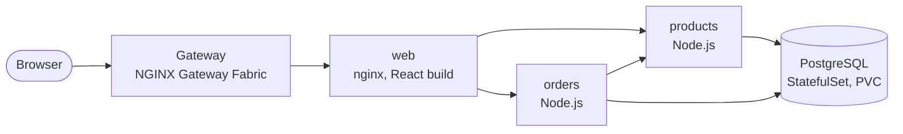

# shopstack-k8s

An e-commerce application on Kubernetes. The cluster and its supporting AWS
infrastructure are defined in Terraform, and deployments run from GitHub Actions
with no stored AWS credentials.

The application itself is small: a catalogue, a cart, and orders. The work is in
how it is packaged, secured, and deployed.

## Architecture



Requests enter through a Gateway API resource served by NGINX Gateway Fabric.
The `web` pod serves the React build and proxies `/api` to the two Node.js
services. Both services use a single PostgreSQL instance running as a
StatefulSet on a persistent volume.

## What runs where

The Helm chart is the same in both environments. Only the values differ.

**AWS.** EKS 1.35, two `t3.medium` nodes across two availability zones, built by
the Terraform in `infra/`. The cluster is built and destroyed per working
session to avoid idle cost.

**Local.** kind, with the same chart and the same component versions.

## Infrastructure

Terraform in `infra/` creates:

- A VPC across two availability zones, private subnets for the nodes, one NAT
  gateway per zone, and flow logs to CloudWatch
- EKS 1.35 with control plane logging and a customer managed KMS key for secret
  encryption
- A managed node group, and the EBS CSI driver bound to its IAM role through EKS
  Pod Identity
- ECR repositories with immutable tags and scanning on push
- An IAM role for GitHub Actions that only this repository can assume

State is held in S3 with native locking.

## Security

- No credentials in the repository or in GitHub. CI obtains short lived AWS
  credentials through GitHub OIDC, and the trust policy is pinned to this
  repository and branch using immutable numeric IDs.
- The deploy role holds `eks:DescribeCluster` in IAM and nothing else. Inside the
  cluster it is scoped to one namespace, and its Gateway API permissions come
  from a group binding rather than cluster admin.
- Containers run as a non root user with a read only root filesystem and all
  Linux capabilities dropped.
- Service accounts do not mount API tokens, because no workload calls the
  Kubernetes API.
- NetworkPolicies select every pod, so pod to pod traffic is denied unless
  explicitly allowed. Each service accepts connections only from its callers.
- PostgreSQL is reachable only from inside the cluster.
- Every workload declares resource requests and limits, and health probes.
- Base images are pinned to explicit versions and scanned with Trivy in CI.
  Terraform is scanned with Trivy as well.
- Dependabot opens dependency pull requests weekly. Major versions are left
  ungrouped so each one is reviewed on its own.

## Continuous integration

Every push and pull request runs:

| Job | What it does |
| --- | --- |
| `test` | Unit and integration tests for both services against a real PostgreSQL container |
| `web` | Lint, type check and build the frontend |
| `chart` | `helm lint`, then render both value sets and validate them against Kubernetes 1.35 and Gateway API schemas with kubeconform |
| `terraform` | `fmt`, `init`, `validate`, and a Trivy configuration scan |
| `scan` | Build all three images and scan them with Trivy for vulnerabilities and secrets |

Actions are pinned to commit SHAs rather than tags.

## Deployment

`.github/workflows/deploy.yml` deploys to EKS on request. It exchanges a GitHub
OIDC token for temporary AWS credentials, fetches cluster access, and runs
`helm upgrade`.

## Running it locally

Requires Docker, kind, kubectl and Helm.

Create the cluster:

```
kind create cluster --config deploy/kind/cluster.yaml
```

Install the Gateway API CRDs and NGINX Gateway Fabric. The node ports must match
the port mappings in `deploy/kind/cluster.yaml`:

```
kubectl apply -f https://github.com/kubernetes-sigs/gateway-api/releases/download/v1.6.3/standard-install.yaml
```

```
helm install ngf oci://ghcr.io/nginx/charts/nginx-gateway-fabric --version 2.8.0 --create-namespace -n nginx-gateway --set nginx.service.type=NodePort --set-json 'nginx.service.nodePorts=[{"port":31437,"listenerPort":80},{"port":30478,"listenerPort":443}]'
```

Build the images and load them into the cluster:

```
docker build -t shopstack/products:dev services/products
docker build -t shopstack/orders:dev services/orders
docker build -t shopstack/web:dev web
```

```
kind load docker-image shopstack/products:dev --name shopstack
kind load docker-image shopstack/orders:dev --name shopstack
kind load docker-image shopstack/web:dev --name shopstack
```

Create the application secret:

```
kubectl create secret generic shopstack-secrets --from-literal=POSTGRES_USER=shopstack --from-literal=POSTGRES_DB=shopstack --from-literal=POSTGRES_PASSWORD="$(openssl rand -hex 24)" --from-literal=JWT_SECRET="$(openssl rand -base64 32)"
```

Generate a self signed certificate for the Gateway and store it as a secret:

```
openssl req -x509 -newkey rsa:2048 -nodes -keyout /tmp/tls.key -out /tmp/tls.crt -days 365 -subj "/CN=shopstack.test" -addext "subjectAltName=DNS:shopstack.test"
```

```
kubectl create secret tls shopstack-tls --cert=/tmp/tls.crt --key=/tmp/tls.key
```

Deploy:

```
helm install shopstack deploy/shopstack -f deploy/shopstack/values-kind.yaml
```

Add `127.0.0.1 shopstack.test` to `/etc/hosts`, then open http://shopstack.test.

Tear down:

```
kind delete cluster --name shopstack
```

## Repository layout

```
infra/               Terraform for the VPC, EKS cluster, ECR and IAM
deploy/kind/         Local cluster definition
deploy/eks/          Cluster add-ons applied once per cluster
deploy/shopstack/    Helm chart for the application
services/products/   Product catalogue service
services/orders/     Cart and order service
web/                 React frontend served by nginx
```
